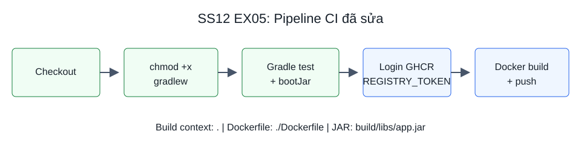
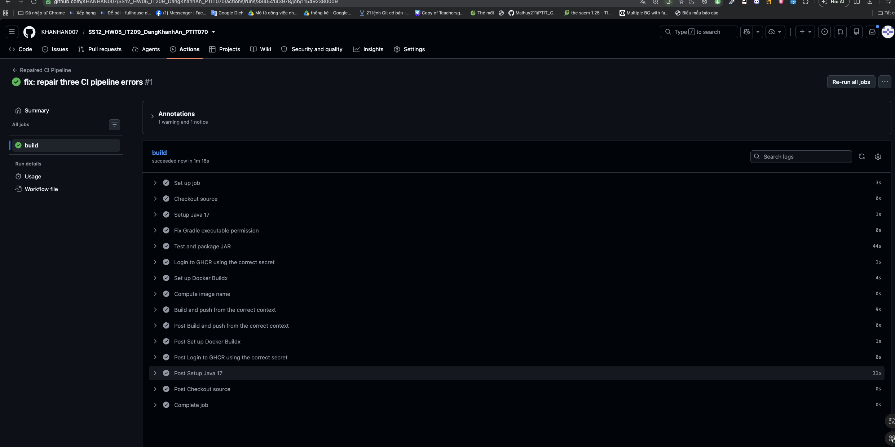

# Báo cáo khắc phục Pipeline CI/CD

## 1. Gradle Wrapper thiếu quyền thực thi

Dấu hiệu thường gặp: `./gradlew: Permission denied`, exit code 126.

Nguyên nhân: file gradlew không có quyền executable trên runner Linux.

Sửa bằng bước trước khi test:

```yaml
- name: Fix Gradle executable permission
  run: chmod +x gradlew
- name: Test and package JAR
  run: ./gradlew test bootJar --no-daemon
```

`bootJar` tạo `build/libs/app.jar` để Dockerfile COPY vào image.

## 2. Đăng nhập Registry sai tên Secret

Dấu hiệu có thể gặp: thiếu username/password, authentication failed hoặc unauthorized. Cần đọc thông báo thực tế để phân biệt Secret không tồn tại với token sai hoặc hết hạn.

Nguyên nhân theo đề: workflow tham chiếu tên Secret không khớp Repository Secret.

Sửa:

```yaml
uses: docker/login-action@v3
with:
  registry: ghcr.io
  username: ${{ github.repository_owner }}
  password: ${{ secrets.REGISTRY_TOKEN }}
```

Secret phải tồn tại trong repository mới, token thuộc tài khoản có quyền ghi package và có scope `write:packages`.

Không in token để debug. Bước login cần có thông báo `Login Succeeded`.

## 3. Sai Docker build context hoặc đường dẫn Dockerfile

Dấu hiệu thường gặp: không tìm thấy Dockerfile, lỗi đọc build definition hoặc lỗi COPY không tìm thấy JAR.

Nguyên nhân theo đề: chỉ định context/file sai vị trí so với repository. File trong COPY phải nằm trong build context và không bị .dockerignore loại bỏ.

Sửa:

```yaml
uses: docker/build-push-action@v5
with:
  context: .
  file: ./Dockerfile
  platforms: linux/amd64
  push: true
```

Checkout đưa source vào workspace; Gradle tạo JAR trong cùng job. Context là gốc repository, Dockerfile là file tại gốc và `build/libs/app.jar` được giữ trong context.

## 4. Sơ đồ pipeline



## 5. Kết quả GitHub Actions

Chưa chạy trên GitHub cho project này. Sau khi push, điền:

| Mục | Kết quả thực tế |
|---|---|
| Link Actions | Chưa có |
| Gradle test và bootJar | Chưa kiểm tra trên Actions |
| Registry login | Chưa kiểm tra trên Actions |
| Docker build/push | Chưa kiểm tra trên Actions |
| Toàn bộ job | Chưa kiểm tra trên Actions |

Sau khi chụp ảnh, nhúng vào báo cáo bằng dòng:

```markdown

```
